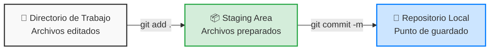
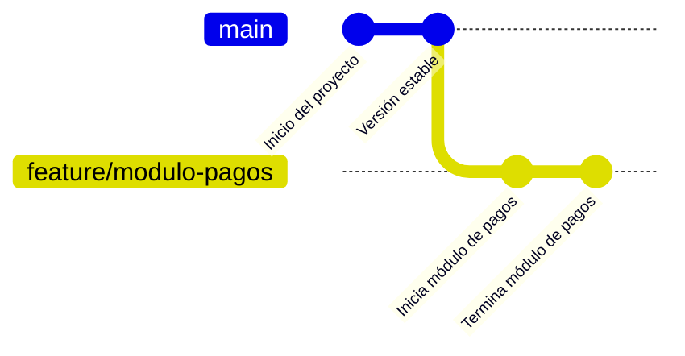
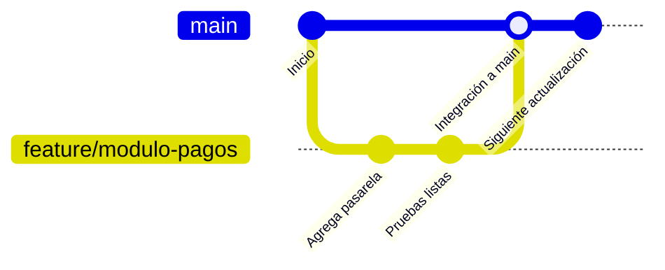
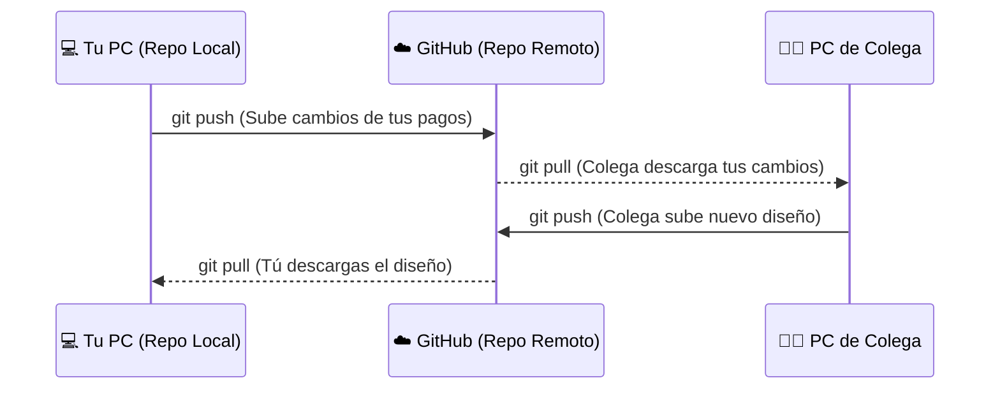

# 🚀 Guía Práctica de Git: Comandos Esenciales

Este repositorio sirve como material de apoyo para entender el flujo de trabajo básico con Git y GitHub. A continuación, explicamos de manera visual y práctica para qué sirve cada comando utilizado en nuestro flujo de desarrollo.
---

## 📸 1. Guardando el progreso: `git add` y `git commit`

Cuando haces cambios en tu código, necesitas decirle a Git explícitamente qué archivos quieres guardar y luego crear ese "punto de guardado".

*   `git add .` : Toma todos los archivos modificados y los prepara en un área de espera (Staging Area).
*   `git commit -m "mensaje"` : Toma los archivos del área de espera y crea una captura o "foto" permanente en el historial de tu repositorio local.

---

## 🌿 2. Creando universos paralelos: `git switch` (Ramas)

Para no romper el código que ya funciona (normalmente en la rama `main`), creamos ramas o *branches*. Esto nos permite experimentar y desarrollar nuevas funcionalidades de forma aislada.

*   `git switch -c <nombre-de-rama>` : Crea una rama nueva y te mueve a ella inmediatamente. (Equivalente al clásico `git checkout -b`).

---

## 🔀 3. Uniendo los caminos: `git merge`

Cuando tu nueva funcionalidad está lista y probada, es momento de integrarla de vuelta a la rama principal.

*   `git switch main` : Primero, regresas a la rama principal.
*   `git merge <nombre-de-rama>` : Fusionas los cambios de tu rama de desarrollo hacia la rama principal en la que te encuentras.

---

## ☁️ 4. Sincronizando con la nube: `git push` y `git pull`

El verdadero poder de Git se desata cuando trabajas con un servidor remoto (como GitHub). Necesitas enviar tus cambios locales y recibir los cambios que tus compañeros han subido.

*   `git push origin <rama>` : "Empuja" (sube) tus commits locales al repositorio remoto en la nube.
*   `git pull origin <rama>` : "Jala" (descarga) los cambios de la nube a tu computadora para mantenerte actualizado.

---

## 🤝 5. Trabajo en equipo: Pull Request (PR)

El **Pull Request** no es un comando de terminal, es una función de GitHub (o GitLab). En lugar de usar `git merge` para unir el código directamente a `main`, subes tu rama a GitHub con `git push` y abres un PR. 

Esto permite que otros desarrolladores revisen tu código, dejen comentarios y aprueben los cambios antes de que se integren oficialmente. Es el filtro de calidad de los equipos de desarrollo.
